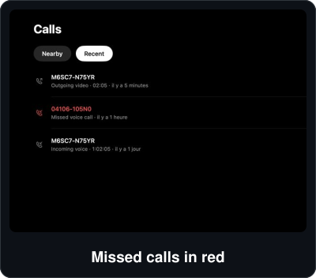
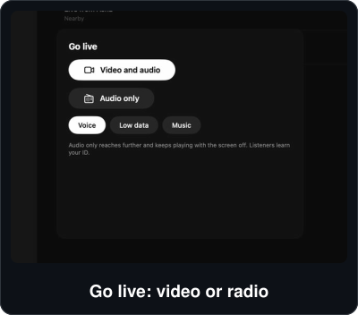
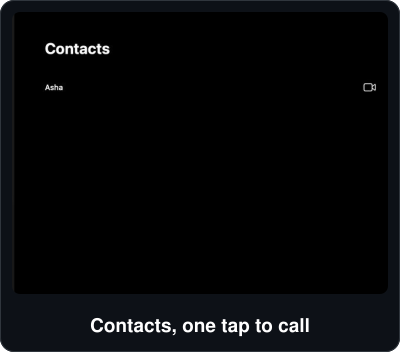

<div align="center">

<picture>
  <source media="(prefers-color-scheme: light)" srcset="docs/assets/hero-light.svg">
  
</picture>

**MeshLive for iPhone and Mac.** Encrypted calls and live video between nearby Apple devices and Android phones, over Bluetooth, with no internet, no account and no server.

<a href="#build-it"></a>&nbsp;
<a href="#what-this-fork-adds"></a>&nbsp;
<a href="#status"></a>&nbsp;
<a href="https://github.com/MeshLive/meshlive-ios"></a>

<br>


-ffffff?style=flat-square&labelColor=0d1117&logo=apple&logoColor=ffffff)


No binary release: you build it on your Mac and sign it with your own Apple team · free software, GPL

English · [Français](README.fr.md)

</div>

---

[MeshLive](https://github.com/MeshLive) sends live camera video and microphone audio straight between nearby phones over Bluetooth LE, encrypted, with nothing in between. This is a fork of [MeshLive for iPhone](https://github.com/MeshLive/meshlive-ios) that adds **a native Mac app** built from the same code, and a few iPhone changes. The wire protocol is unchanged: it still talks to the iPhone and [Android](https://github.com/MeshLive/meshlive-android) apps.

> **Early software, not audited.** Calls and lives between one Mac and one iPhone have been tried by hand. Nothing here has been tried against an Android phone, and the protocol has had no independent security review. Do not rely on it where your safety depends on it. Read [What nearby devices can see](#what-nearby-devices-can-see) first.

## What it does

<table>
  <tr>
    <td></td>
    <td></td>
    <td></td>
  </tr>
  <tr>
    <td></td>
    <td></td>
    <td></td>
  </tr>
</table>

## What this fork adds

**A Mac app (Mac Catalyst, Apple silicon)**

- The whole app on the Mac: calls, lives, watching, contacts, identity verification, settings.
- A Mac layout: sidebar instead of the tab bar, no title bar, phone-width columns in a wide window, full screen without a bar over the call.
- Uses the Mac's built-in camera (skips virtual cameras), sends landscape 426×240 video.
- Stays reachable when the window is hidden or minimized: macOS does not suspend apps, so an incoming call still rings.
- Named `MeshLive.app` in the Finder, the menu bar and permission prompts, with a full-size icon on macOS 26 and later.
- Two crash fixes found on the Mac: the call screen and the Go live sheet lost the app's model.

**On the iPhone**

- The interface turns to landscape. The camera follows the phone, and the stream it sends keeps the same portrait size (centre crop, no protocol change).
- Missed calls: a badge on Calls, Recent opens on its own, missed rows in red as in the Phone app.
- Rename a verified contact (a local label only).
- A green Accept button, and a person glyph instead of a digit for peers without a name.
- **Experimental, off by default:** "Reachable in the background" (Settings › Experiments). A backgrounded iPhone keeps a fixed Bluetooth beacon, and nearby iPhones and Macs read its announcement over GATT, so they can still call it and it rings as a notification. Android cannot see a backgrounded iPhone, and a closed app cannot ring. Not yet tried on hardware.

## Status

| | Mac ↔ iPhone | Apple ↔ Android |
| --- | --- | --- |
| Voice and video calls | tried by hand, one Mac, one iPhone | not tried here (see [upstream status](https://github.com/MeshLive/meshlive-ios#status)) |
| Go live and watch | tried by hand | not tried here |
| Background reachability | built, unit tests pass, not tried on hardware | impossible: iOS hides a backgrounded iPhone from Android |

- The 175 core, media and protocol tests pass (`bash Scripts/test.sh`).
- The Mac app needs Apple silicon: the codecs have no Intel Catalyst slice.
- Everything the upstream app lists as untested is still untested here.

## Build it

You need a Mac with Xcode 26 or later, Python 3, and internet for the first build (the scripts fetch the pinned libopus and libvpx sources). No third-party binaries are in the repository.

```sh
bash Scripts/prepare-opus.sh      # libopus 1.6.1 -> Vendor/Opus.xcframework (iPhone, simulator, Mac slices)
bash Scripts/prepare-libvpx.sh    # libvpx 1.15.2 -> Vendor/VPX.xcframework
python3 Scripts/project.py        # regenerate NearbyIntercom.xcodeproj (no signing data)
bash Scripts/test.sh              # core, media and protocol tests
```

**Mac app.** Signed ad hoc, for your own Mac. It ends up in `.build/catalyst/Build/Products/Debug-maccatalyst/MeshLive.app`.

```sh
xcodebuild -project NearbyIntercom.xcodeproj -scheme NearbyIntercom \
  -destination 'platform=macOS,variant=Mac Catalyst,arch=arm64' -configuration Debug \
  -derivedDataPath .build/catalyst CODE_SIGN_IDENTITY=- CODE_SIGN_STYLE=Manual DEVELOPMENT_TEAM= build
```

**iPhone.** Signed with your own team, on a phone with iOS 16 or later. Keep it unlocked:

```sh
TEAM=<your team id> BUNDLE=<a unique bundle id> bash Scripts/run-device.sh
```

Allow Bluetooth, Camera and Microphone when asked. To regenerate the pictures in this README, run `python3 docs/assets/make_svgs.py`. The captures in `docs/assets/readme-src/` come from the Mac app launched with `-NearbyFixture populated`, which shows made-up people only.

## What nearby devices can see

Anyone with a Bluetooth scanner in range can see that a MeshLive device is nearby. Calls and streams are encrypted, their presence is not.

- **A stable ID prefix.** While the app is open and offering a call or a stream, it advertises a 48-bit prefix of its node ID, and that prefix does not change. A scanner can use it to link the device's changing Bluetooth addresses over days. Rotating IDs exist but are experimental.
- **Who you are, on connection.** The handshake that opens every connection carries the public key in clear, so a connection attempt reveals the identity.
- **The background beacon** (only if you turn the experiment on): the fixed beacon says "a MeshLive iPhone is here" to Apple devices, and any device that connects can read the same announcement the phone shows in the foreground.

To reduce exposure: close the app or switch Bluetooth off when you don't need it, leave names and titles off, and give your phone a neutral name. The [upstream README](https://github.com/MeshLive/meshlive-ios#what-nearby-phones-can-see) has the full details.

## Upstream

[MeshLive/meshlive-ios](https://github.com/MeshLive/meshlive-ios) owns the iPhone app, and [meshlive-android](https://github.com/MeshLive/meshlive-android) owns the protocol. Fixes from this fork go back upstream as pull requests: [CI and the AV1 decoder check](https://github.com/MeshLive/meshlive-ios/pull/2) is the first. Every commit is signed off (`git commit -s`), as [CONTRIBUTING.md](CONTRIBUTING.md) asks. Security problems go through [SECURITY.md](SECURITY.md), never a public issue.

## License

GPL-3.0-or-later, like upstream: you may use, change and share it, and changed versions you distribute stay under the same licence. Copyright (C) 2026 The MeshLive Authors (see [AUTHORS](AUTHORS)), full text in [LICENSE](LICENSE). libopus and libvpx keep their BSD-3-Clause licences; see [Vendor/README.md](Vendor/README.md).

<sub>An independent fork, not an official MeshLive release. Apple, iPhone, Mac and macOS are trademarks of Apple Inc.</sub>
